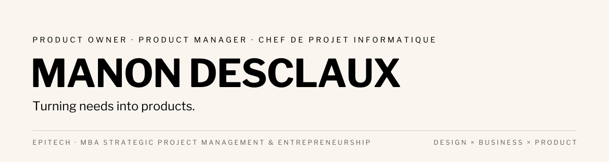

<picture>
  <source media="(prefers-color-scheme: dark)" srcset="assets/banner-dark.svg">
  
</picture>

  <a href="https://manondesclaux.github.io">Portfolio</a> &nbsp;·&nbsp;
  <a href="https://manondesclaux.github.io/documents/Manon_Desclaux_CV.pdf">CV</a> &nbsp;·&nbsp;
  <a href="https://www.linkedin.com/in/manon-desclaux">LinkedIn</a> &nbsp;·&nbsp;
  <a href="mailto:manondesclaux.pro@gmail.com">manondesclaux.pro@gmail.com</a>

### 01 — À propos

Plus de dix ans à la croisée du design, de l'expérience client et du pilotage de projets, dont la création et la direction de **Made Architecture** depuis 2021. Je mets aujourd'hui cette expérience au service du Product Management et du Product Ownership.

En [MBA Strategic Project Management & Entrepreneurship](https://www.epitech.eu/formation-alternance/mba-strategic-project-management-entrepreneurship/) à Epitech (promo 2028), qui délivre le titre d'[Architecte des systèmes d'information](https://www.francecompetences.fr/recherche/rncp/42634) (RNCP 42634, niveau 7). En parallèle, je porte **Tribeat**, mon projet d'application food, suivi dans Jira.

### 02 — Compétences

| User discovery | Project management | UX & branding | Business & data |
|---|---|---|---|
| Besoins, usages, irritants, attentes des utilisateurs | Cadrage, planning, priorisation, coordination jusqu'à 15 parties prenantes | Parcours, wireframes, interfaces, identité | Analyse, segmentation, aide à la décision, conformité RGPD |

### 03 — Projets

| | Projet | La question | Outils |
|---|---|---|---|
| 01 | [Hackathon Citiz · Mobilité 06](https://github.com/manondesclaux/Hackathon-Citiz-Mobilite-06) | Où implanter de l'autopartage dans les Alpes-Maritimes, et à quel coût ? | Python, scikit-learn, OSM, Microsoft Fabric |
| 02 | [Segmentation Instagram](https://github.com/manondesclaux/Rush-4-Segmentation-Instagram) | Quels segments d'utilisateurs selon l'usage et le bien-être ? | Python, Streamlit |
| 03 | [Satisfaction passagers](https://github.com/manondesclaux/Rush-3-Satisfaction-passagers) | Où investir le budget expérience client, et quels passagers approcher ? | Python, Jupyter |
| 04 | [Ventes en pharmacie](https://github.com/manondesclaux/Rush-2-Analyse-ventes-pharmacie) | Peut-on prévoir les ventes du mois suivant, et partager les données ? | Python, pandas, Excel |

Études de cas produit et design (Made Architecture, Florosie, Retail to Product) : [sur le portfolio](https://manondesclaux.github.io).

### 04 — Outils

**Produit** &nbsp; Jira · Microsoft Fabric · Excel 
**Data** &nbsp; Python · pandas · scikit-learn · Jupyter · Streamlit 
**Web** &nbsp; HTML · CSS · Git
