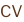

<picture>
  <source media="(prefers-color-scheme: dark)" srcset="assets/banner-dark.svg">
  
</picture>

  <a href="https://manondesclaux.github.io"><picture><source media="(prefers-color-scheme: dark)" srcset="assets/lien-portfolio-dark.svg"></picture></a> &nbsp; &nbsp; &nbsp;
  <a href="https://manondesclaux.github.io/documents/Manon_Desclaux_CV.pdf"><picture><source media="(prefers-color-scheme: dark)" srcset="assets/lien-cv-dark.svg"></picture></a> &nbsp; &nbsp; &nbsp;
  <a href="https://www.linkedin.com/in/manon-desclaux"><picture><source media="(prefers-color-scheme: dark)" srcset="assets/lien-linkedin-dark.svg"></picture></a> &nbsp; &nbsp; &nbsp;
  <a href="mailto:manondesclaux.pro@gmail.com"><picture><source media="(prefers-color-scheme: dark)" srcset="assets/lien-email-dark.svg"></picture></a>

### 01 – À propos

Plus de dix ans à la croisée du design, de l'expérience client et du pilotage de projets, dont la création et la direction de **Made Architecture** depuis 2021. Je mets aujourd'hui cette expérience au service du Product Management, du Product Ownership et de la gestion de projets informatiques.

En **MBA Strategic Project Management & Entrepreneurship** à Epitech (promo 2028), qui délivre le titre d'**Architecte des systèmes d'information** (RNCP 42634, niveau 7). En parallèle, je porte **Tribeat**, mon projet d'application food, suivi dans Jira.

### 02 – Compétences

| User discovery | Gestion de projet | UX & branding | Business & data |
|---|---|---|---|
| Besoins, usages, irritants, attentes des utilisateurs | Cadrage, planning, priorisation, coordination jusqu'à 15 parties prenantes | Parcours, wireframes, interfaces, identité | Analyse, segmentation, aide à la décision, conformité RGPD |

### 03 – Projets

| | Projet | La question | Outils |
|---|---|---|---|
| 01 | <a href="https://github.com/manondesclaux/Hackathon-Citiz-Mobilite-06"><picture><source media="(prefers-color-scheme: dark)" srcset="assets/lien-projet-citiz-dark.svg"></picture></a> | Où implanter de l'autopartage dans les Alpes-Maritimes (06), et à quel coût ? | Python, scikit-learn, OSM, Microsoft Fabric |
| 02 | <a href="https://github.com/manondesclaux/Rush-4-Segmentation-Instagram"><picture><source media="(prefers-color-scheme: dark)" srcset="assets/lien-projet-instagram-dark.svg"></picture></a> | Quels segments d'utilisateurs selon l'usage et le bien-être ? | Python, Streamlit |
| 03 | <a href="https://github.com/manondesclaux/Rush-3-Satisfaction-passagers"><picture><source media="(prefers-color-scheme: dark)" srcset="assets/lien-projet-passagers-dark.svg"></picture></a> | Où investir le budget expérience client, et quels passagers approcher ? | Python, Jupyter |
| 04 | <a href="https://github.com/manondesclaux/Rush-2-Analyse-ventes-pharmacie"><picture><source media="(prefers-color-scheme: dark)" srcset="assets/lien-projet-pharmacie-dark.svg"></picture></a> | Peut-on prévoir les ventes du mois suivant, et partager les données ? | Python, pandas, Excel |
| 05 | <a href="https://github.com/manondesclaux/Rush-1-Analyse-TikTok"><picture><source media="(prefers-color-scheme: dark)" srcset="assets/lien-projet-tiktok-dark.svg"></picture></a> | Qu'est-ce qui distingue les contenus performants, et quels créateurs contacter ? | Excel |
| 06 | <a href="https://github.com/manondesclaux/manondesclaux.github.io"><picture><source media="(prefers-color-scheme: dark)" srcset="assets/lien-projet-portfolio-dark.svg"></picture></a> | Présenter mon parcours et mes études de cas, sans framework | HTML, CSS, JavaScript |

Les études de cas produit et design (Made Architecture, Florosie, Retail to Product) sont sur mon portfolio.

### 04 – Outils

**Produit** &nbsp; Jira · Microsoft Fabric · Excel 
**Data** &nbsp; Python · pandas · scikit-learn · Jupyter · Streamlit 
**Web** &nbsp; HTML · CSS · JavaScript · Git
